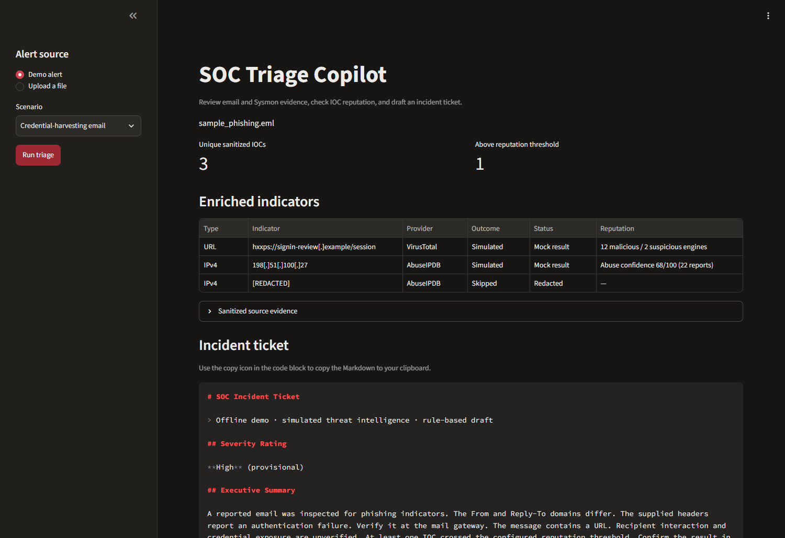
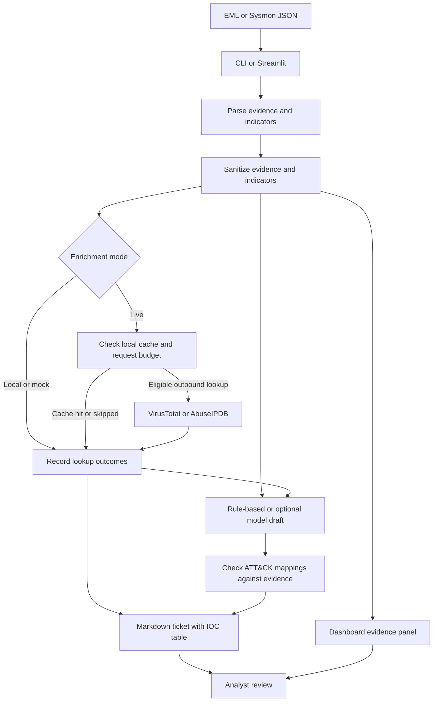

# SOC Triage Copilot

Turn a reported email or suspicious Sysmon export into a Tier-2 incident ticket. The pipeline extracts indicators of compromise (IOCs), redacts internal details, checks threat reputation, and produces Markdown for analyst review.

## Try the recruiter demo

From the project folder with Python 3.11 or newer, run:

```powershell
python app.py --demo
```

The demo uses Python's standard library and runs without API keys or installations. It prints three complete tickets using fictional evidence and clearly labeled simulated reputation data.



The screenshot and example ticket use the same fictional alert and simulated results. [Read the complete phishing ticket](docs/example-phishing-ticket.md).

| Demo | What to look for |
| --- | --- |
| Credential-harvesting email | Reply-To mismatch, reported SPF/DKIM failures, URL reputation, and private relay IP redaction |
| Encoded PowerShell | Sysmon process creation, a synthetic SHA-256 reputation lookup, and an Execution mapping |
| Suspected outbound beaconing | Repeated outbound connections, destination IP reputation, and a candidate Command and Control mapping |

## Architecture



## Triage a file

```powershell
# Local parsing and a rule-based ticket
python app.py data/sample_phishing.eml

# Simulated enrichment for one alert, saved as Markdown
python app.py data/sample_sysmon.json --mock --output incident-ticket.md
```

The CLI accepts `.eml` messages with headers alone or MIME text bodies, and `.json` exports containing a Sysmon event, a list of events, or an `events` array. It handles flat, Windows EventData, and Winlogbeat-style fields. Inputs are limited to 2 MiB. Keep related Sysmon events in the same file to enable basic correlation.

The ticket contains a provisional severity, plain-English executive summary, MITRE ATT&CK tactic/technique, enriched IOC table, and proposed containment checklist. Paste the Markdown into a Jira or ServiceNow incident for analyst review.

## Streamlit dashboard

```powershell
python -m venv .venv
.\.venv\Scripts\python.exe -m pip install -r requirements.txt
.\.venv\Scripts\python.exe -m streamlit run streamlit_app.py --server.address 127.0.0.1 --browser.gatherUsageStats false
```

On macOS or Linux, use `./.venv/bin/python` for the last two commands. Pick a demo or drag an alert into **Upload a file**, then select **Run triage**. The dashboard displays the IOC table and ticket. Use the code block's copy icon to copy the Markdown or download it as a file.

## Live enrichment and drafting

Install `requirements.txt` using the setup above. Set the keys for the services you want to enable in the same shell, then pass `--live` or choose **Live APIs** in the dashboard. In Bash, use `export NAME='value'` instead of PowerShell's `$env:NAME = 'value'`.

```powershell
$env:VIRUSTOTAL_API_KEY = '<your key>'
$env:ABUSEIPDB_API_KEY = '<your key>'
$env:OPENAI_API_KEY = '<your key>'
$env:OPENAI_MODEL = 'gpt-5-mini'  # Optional override
.\.venv\Scripts\python.exe app.py path\to\approved-alert.json --live
```

| Integration | Use |
| --- | --- |
| VirusTotal v3 | Looks up existing URL and SHA-256 reports with GET requests. Supports public API credentials subject to provider limits. |
| AbuseIPDB v2 | Checks public IPv4 addresses for abuse confidence and report count over the past 90 days. |
| OpenAI Responses API | Drafts the ticket from sanitized evidence and normalized reputation scores. Uses the `LLMClient` interface so another provider can be added later. OpenAI API usage is billed separately. |

Lookups are capped at four per threat-intel provider per alert. The ticket reports how many indicators were checked, returned no record, were skipped, failed, or used simulated data. Its IOC table shows the per-indicator outcome and reason from the pipeline. Skipped, failed, and no-record outcomes leave reputation unknown. Expand **Sanitized source evidence** in the dashboard to compare the draft with parsed email headers or Sysmon event fields. The pipeline uses a rule-based draft when the selected model is unavailable or returns an incomplete ticket.

Live lookups share a local SQLite cache across dashboard and CLI runs. The cache keeps scores for 15 minutes and no-record responses for 5 minutes. The IOC table labels cache hits, and they use no request budget. The app applies rolling limits per configured API key of four requests per minute and 500 per day for VirusTotal, and 1,000 per day for AbuseIPDB. When a provider returns HTTP 429, the app pauses outbound requests to that provider for the `Retry-After` interval, or 60 seconds if the header is unavailable. These local limits account for requests made through this cache. Requests made elsewhere may still trigger provider limits. The default database is `.cache/lookups.sqlite3` and is ignored by Git. It stores digests, lookup outcomes, scores, and timing data. API keys and indicator strings are kept out of the database.

## Local drafting with Ollama

Install the Python requirements and [Ollama](https://ollama.com/download). Start Ollama on the same machine as the app. For local-only inference, [disable Ollama cloud features](https://docs.ollama.com/faq#how-do-i-disable-ollamas-cloud-features) with `OLLAMA_NO_CLOUD=1` in the server environment and restart Ollama.

```powershell
ollama pull llama3.2
.\.venv\Scripts\python.exe app.py data/sample_sysmon.json --ollama
```

Set `$env:OLLAMA_MODEL` to use another installed local model. In Streamlit, choose **Upload a file**, then select **Ollama (local)** under **Ticket drafting**. The app sends sanitized evidence to Ollama at `127.0.0.1:11434`. Add `--live` for external IOC reputation checks with local drafting, or add `--mock` for simulated reputation results. `--demo` still works without a model or dependencies.

## Local drafting with LM Studio

1. Open LM Studio, select a downloaded local model, and load it.
2. Open the **Developer** tab and start the local server on port `1234`. Keep LM Studio running.
3. In PowerShell, retrieve the exact identifier from the server:

   ```powershell
   (Invoke-RestMethod http://127.0.0.1:1234/v1/models).data.id
   ```

4. Use an identifier from that list in the CLI:

   ```powershell
   .\.venv\Scripts\python.exe app.py data/sample_sysmon.json --lm-studio --model '<model-identifier>'
   ```

   Alternatively set `$env:LM_STUDIO_MODEL` to the identifier and omit `--model`.

In the dashboard, select **Upload a file**, choose **LM Studio (local)** under **Ticket drafting**, and enter the model identifier. The app sends sanitized evidence to `127.0.0.1:1234`. **Local only** skips external enrichment, and **Mock results** uses simulated reputation scores. Live enrichment can be combined with local drafting. A fallback ticket includes the reason if the server is unreachable, the model is unavailable, or its output is incomplete.

## Data handling

Local and mock modes keep alert data on the machine when using rule-based drafting or a locally loaded Ollama or LM Studio model. Live mode sends eligible public IPs, full eligible URLs, or hashes to configured intel providers. When OpenAI is selected and configured, it receives selected sanitized evidence, including email addresses, authentication headers, or process command lines. Use approved alerts for live mode. Redaction covers RFC1918 IPv4 addresses, Windows profile names in `C:\Users\<user>` paths, and credentials in URL userinfo. Other sensitive strings, such as tokens in query parameters or command arguments, can remain in the evidence.

The pipeline extracts indicators without opening their destinations or executing command lines. It defangs IOCs in the ticket and proposes containment actions for a human reviewer. Reputation thresholds and ATT&CK mappings serve as triage cues that need corroboration from mail, endpoint, or network telemetry.

## Tests

```powershell
.\.venv\Scripts\python.exe -m pytest -q
```

The suite covers EML and Sysmon parsing, redaction, the offline CLI, and provider request/response handling with mocked services.

## ATT&CK validation and model evaluation

The ticket checks model-suggested technique IDs against the bundled Enterprise ATT&CK 20.1 index. It uses official technique names and labels the evidence separately. A link with an authentication or sender anomaly is a phishing candidate, and repeated TCP connections are only a web-protocol candidate. An observed PowerShell interpreter with the encoded-command flag supports the PowerShell mapping. Other valid suggestions are marked as lacking established evidence support under the current rules. The index is derived from MITRE STIX and its redistribution license is included in `data/ATTACK-LICENSE.txt`.

With LM Studio running locally, evaluate a loaded model against five fictional alerts:

```powershell
.\.venv\Scripts\python.exe evaluate.py --model qwen3.8-9b-distill
```

The evaluation checks original model drafts in local-only mode. It reports unexpected or missing technique IDs, specific phrases that confuse unknown reputation with an external result, and specific claims that containment was performed. It counts rule-based fallbacks separately. Phrase checks cover known failure patterns and require human review for wording they miss.

## References

- [VirusTotal URL reports](https://docs.virustotal.com/reference/url-info) and [file reports](https://docs.virustotal.com/reference/file-info)
- [AbuseIPDB Check API](https://docs.abuseipdb.com/#check-endpoint)
- [OpenAI API quickstart](https://developers.openai.com/api/docs/quickstart) and [GPT-5 mini](https://developers.openai.com/api/docs/models/gpt-5-mini)
- MITRE ATT&CK [Spearphishing Link](https://attack.mitre.org/techniques/T1566/002/), [PowerShell](https://attack.mitre.org/techniques/T1059/001/), and [Web Protocols](https://attack.mitre.org/techniques/T1071/001/)
